# Гайд для мастеров ИТ-ремонта

**Пошаговый гайд для выездных мастеров: от установки приложения до закрытой первой заявки. Одна страница для телефона, без интернета и без зависимостей.**

[](https://github.com/Alpha-Oi/field-tech-guide/actions/workflows/ci.yml)
[](LICENSE)
[](#быстрый-старт)
[](#качество)
[](https://alpha-oi.github.io/field-tech-guide/)

**[Живое демо](https://alpha-oi.github.io/field-tech-guide/)** · [Релизы](https://github.com/Alpha-Oi/field-tech-guide/releases) · [Журнал изменений](CHANGELOG.md) · [Архитектура](docs/architecture.md)

<p align="center">
  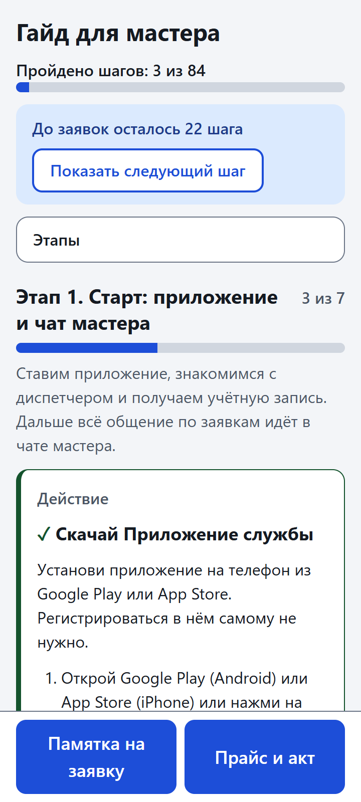
</p>

**Для кого:** новые мастера сервиса (читают страницу с телефона), техдир (раздаёт гайд и смотрит чат мастера) и тот, кто заказывает и внедряет гайд в компании.

> **Оговорка.** Всё демо-содержимое — пример. Названия приложений, ники, ссылки (`example.com`), цены и проценты в демо-профиле и демо-прайсе вымышленные, а все снимки в этом README сняты на них. Настоящие данные компании в репозиторий не входят: они лежат в локальной папке `private/`, которую git не видит.

## Проблема и решение

Новому мастеру приходится собирать порядок работы из переписки, документов и устных советов: что скачать и купить, что нажать в приложении, что написать в чат, как посчитать отчёт и составить акт. Шаги теряются, одни и те же вопросы задают снова, а техдиру трудно понять, кто до какого места дошёл.

Решение: **один набор текстов и данных компании превращается в три готовых файла**.

- Страница `index.html` для телефона: этапы и шаги, у каждого шага проверяемый конец «Готово, когда …», отметки и прогресс, готовые сообщения для чата, «Памятка на заявку», калькулятор отчёта и панель «Прайс и акт».
- Текстовая версия `guide.md` для пересылки в чат и печати.
- Записка техдиру `for-techdir.md`: как внедрить гайд, чтобы мастера его выполняли.

Тексты лежат отдельно от кода, всё, что принадлежит компании, — переменные профиля. Поэтому гайд правят без программиста, а в публичном репозитории нет ничего чужого.

## Что получают

| | |
|---|---|
| **Мастер** | Понятный путь по этапам с отметками «Сделано», «Куплено», «Прочитал». Готовые сообщения для чата с кнопкой «Скопировать», в которые подставляются номер заявки и телефон. Расчёт «Чистыми» для отчёта, выбор услуг из прайса и текст для бланка акта. Всё работает на телефоне без интернета. |
| **Техдир** | Записка «как внедрить» с готовым первым сообщением мастеру. Подтверждением служат сообщения и скрины в чате мастера, а не отметка на странице: у гайда нет сервера и учётных записей, поэтому нечего администрировать. Правки текстов не требуют правки кода. |
| **Заказчик** | Репозиторий продакшн-качества: одна команда сборки, проверка контента с понятными ошибками, тесты, защита от утечки данных компании, документы проекта. Файлы готовы к раздаче: страницу можно переслать файлом или выложить по ссылке. |

## Возможности

<table>
  <tr>
    <td align="center" valign="top" width="33%">
      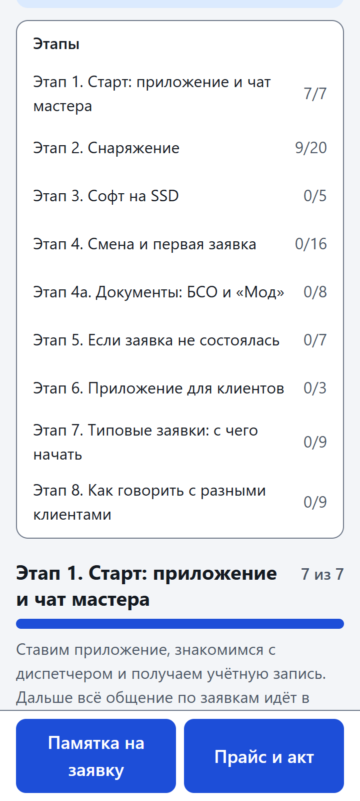<br>
      <b>Этапы и прогресс.</b> Девять этапов с номерами 1–8 и 4а, общий прогресс и прогресс по каждому этапу. Прогресс запоминается на телефоне.
    </td>
    <td align="center" valign="top" width="33%">
      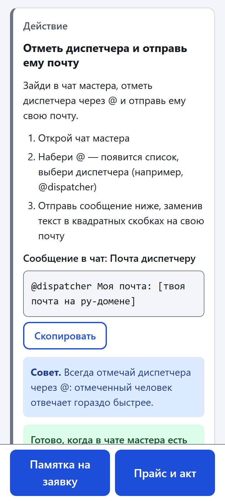<br>
      <b>Готовые сообщения.</b> Везде, где нужно написать в чат, лежит готовый текст и кнопка «Скопировать». Если буфер обмена недоступен, текст выделяется для ручного копирования.
    </td>
    <td align="center" valign="top" width="33%">
      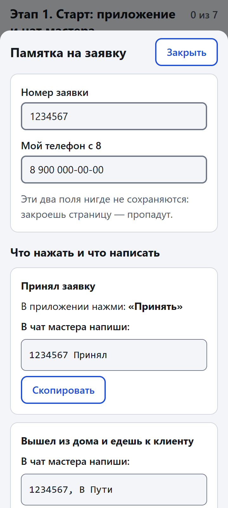<br>
      <b>Памятка на заявку.</b> Кнопка всегда внизу экрана. Цепочка «когда → что нажать в приложении → что написать в чат»; номер заявки и телефон нигде не сохраняются.
    </td>
  </tr>
  <tr>
    <td align="center" valign="top" width="33%">
      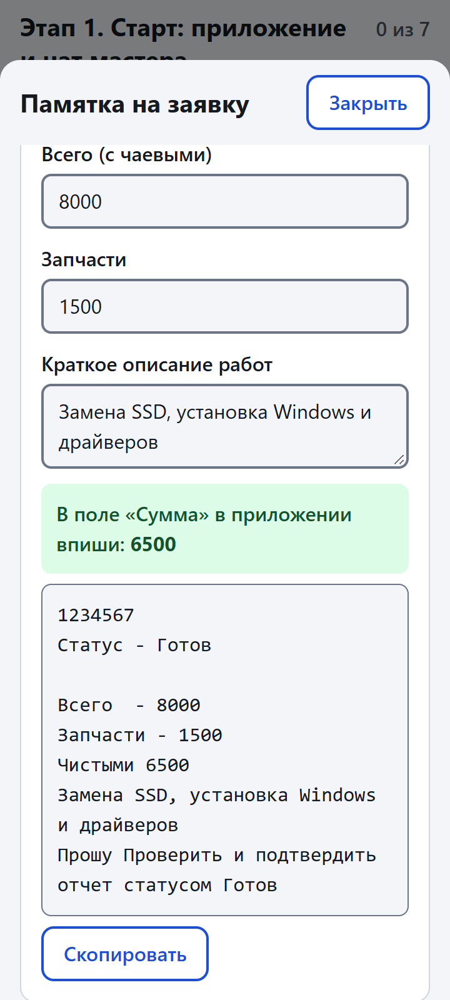<br>
      <b>Отчёты с «Чистыми».</b> «Чистыми» = «Всего» − «Запчасти»; страница подсказывает число для поля «Сумма» и собирает отчёт по форме. Формы отчётов описаны данными.
    </td>
    <td align="center" valign="top" width="33%">
      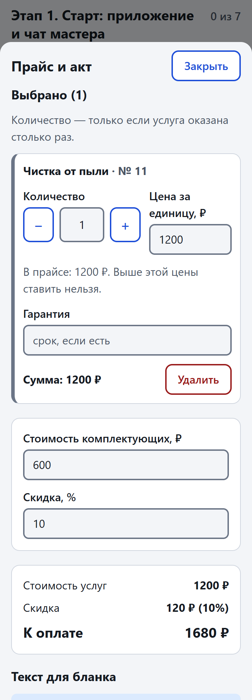<br>
      <b>Прайс и акт.</b> Поиск по прайсу и таблицам «модель × услуга», количество и цена (выше прайса поставить нельзя), комплектующие, скидка, «К оплате» и текст для бланка.
    </td>
    <td align="center" valign="top" width="33%">
      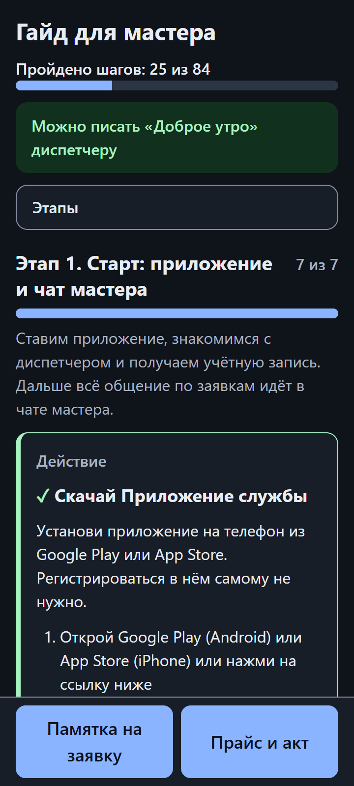<br>
      <b>Тёмная тема и готовность.</b> Тема следует настройке системы. Когда обязательные шаги этапов 1–3 отмечены, подсказка сообщает, что можно писать диспетчеру.
    </td>
  </tr>
</table>

На компьютере страница остаётся одной колонкой, а панели открываются по центру:

<p align="center">
  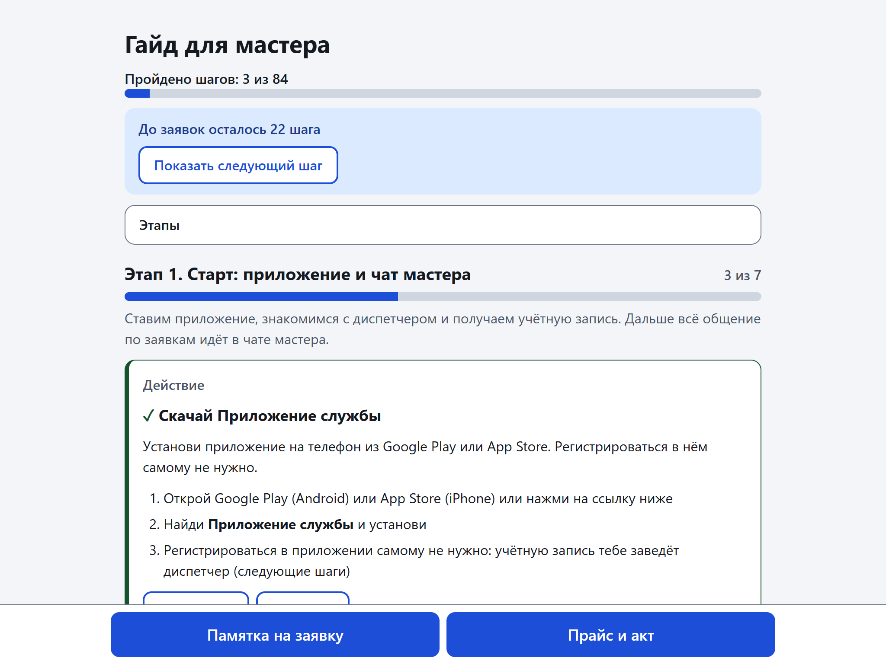
</p>

## Как это устроено

Из контента, профиля и прайса команда `python guide/build.py` собирает три файла. Подробности — в [docs/architecture.md](docs/architecture.md); почему проект устроен именно так, объясняют [записи решений](docs/adr/README.md), а значения слов проекта («шаг», «профиль», «заглушка», «Мод») — [словарь CONTEXT.md](CONTEXT.md).

**Поток данных**

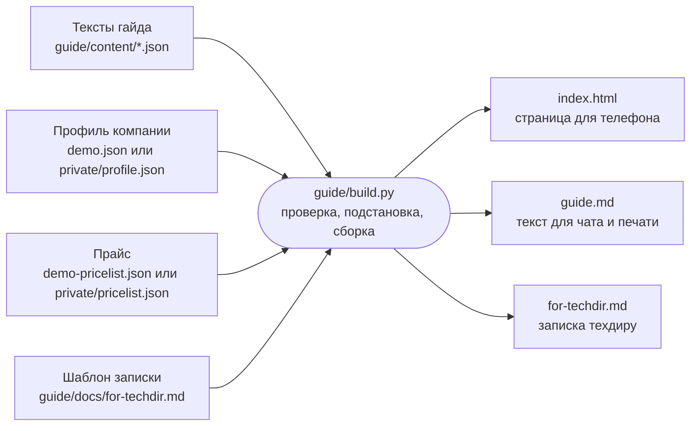

**Карта этапов гайда** (порядок и названия — из `guide/content/*.json`; подсказка «Готов к первой заявке» ждёт обязательные шаги этапов 1–3)

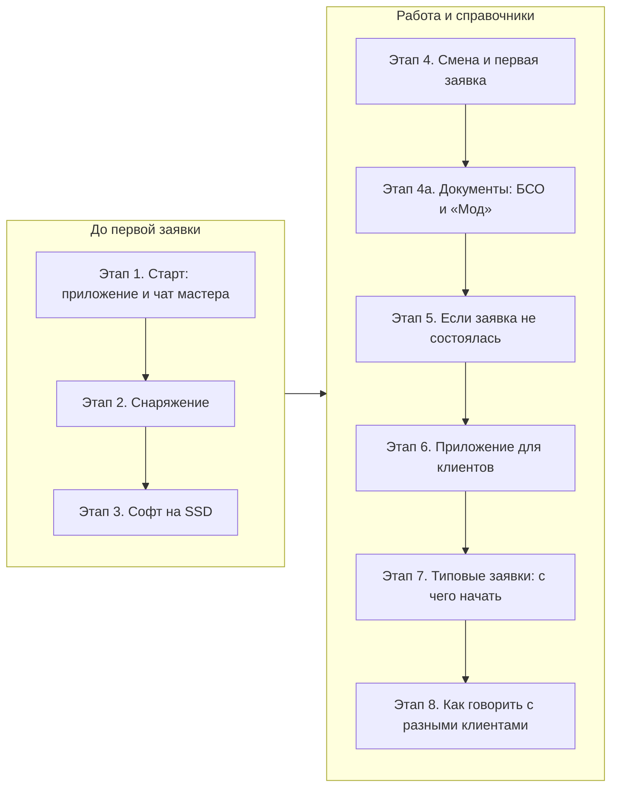

**Жизненный цикл заявки** (так, как его ведёт «Памятка на заявку»)

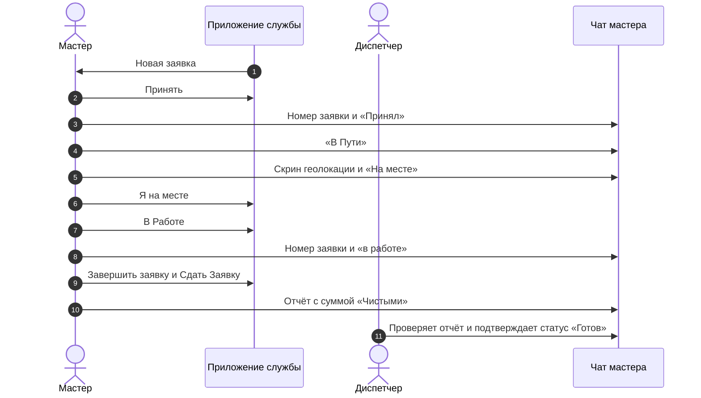

**Шагов по этапам.** График строит `python tools/make_charts.py` из тех же файлов контента; `python tools/make_charts.py --check` проверяет, что картинка в репозитории свежая.

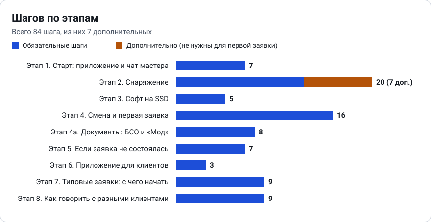

Картинка для карточки репозитория лежит в [docs/img/social-preview.png](docs/img/social-preview.png) (1280×640).

## Качество

- **Тесты: 583.** Стандартный `unittest`, запуск одной командой (см. ниже). Проверяются сборка и проверка контента, прайс и расчёт акта, логика страницы (через `node`; без `node` такие тесты пропускаются с пометкой, а в CI — падают), защита от утечек, документы проекта и график.
- **Ноль зависимостей.** Только Python 3.10+ и его стандартная библиотека; страница — чистые HTML, CSS и JS без сборщика и без npm.
- **Работает офлайн.** `index.html` — один файл: ни CDN, ни внешних шрифтов, ни аналитики, ни картинок по ссылкам. Тест проверяет, что в шаблоне нет внешних адресов и сетевых вызовов.
- **Безопасная страница.** Данные попадают в страницу только через `textContent` и `createElement`, а не как HTML-строки. Номер заявки, телефон и выбор услуг живут в памяти открытой страницы и не попадают ни на диск, ни в `localStorage`; сохраняются только отметки шагов. Обращения к `localStorage` и буферу обмена обёрнуты в `try/catch`: без них страница работает полностью.
- **Доступность.** `lang="ru"`, контрастные цвета в светлой и тёмной темах, видимый фокус с клавиатуры, подписи к полям и панелям, кнопки не меньше 44 px, текст не меньше 16 px, учёт настройки «меньше анимации», печатный вид.
- **Защита от утечки данных компании.** `python tools/check_public.py` падает, если в файлах репозитория есть запрещённые расширения (`docx`, `pdf`, `jpg`, `jpeg`), пути к локальным дискам или слова из локального списка `private/markers.txt`; сами слова в вывод не попадают. Подробнее — в [docs/privacy.md](docs/privacy.md).
- **Проверка целиком** одной командой:

  ```
  python -m unittest discover -s guide/tests -t . && python guide/build.py --check && python tools/check_public.py && python tools/make_charts.py --check
  ```

- **CI.** Workflow `.github/workflows/ci.yml` (проверка на каждый push и pull request) и `.github/workflows/pages.yml` (публикация демо на GitHub Pages) работают: CI проходит на каждый push и pull request, демо автоматически выкатывается на GitHub Pages. Версии действий закреплены и обновляются через Dependabot.

## Быстрый старт

Нужен Python 3.10 или новее (на Windows команда `python`, на macOS и Linux может быть `python3`). Три команды одинаково работают в bash и в PowerShell:

```
git clone https://github.com/Alpha-Oi/field-tech-guide.git
cd field-tech-guide
python guide/build.py
```

В папке `dist/` появятся `index.html`, `guide.md` и `for-techdir.md` с демо-профилем и демо-прайсом. Откройте `dist/index.html` в браузере двойным щелчком: сервер не нужен.

Проверить контент, профиль и прайс без сборки: `python guide/build.py --check`. Ошибки печатаются по-русски с указанием места.

## Свои данные

Тексты в `guide/content/*.json` нейтральные: название приложения, ник диспетчера, ссылки, цены и ставки записаны переменными `{{имя}}`. Значения лежат в профиле, а услуги и цены — в прайсе.

1. Создайте локальную папку `private/` (в git она не попадает) и скопируйте в неё демо-профиль. Из корня репозитория, в bash:

   ```
   mkdir -p private
   cp guide/profiles/demo.json private/profile.json
   ```

   то же в PowerShell:

   ```
   New-Item -ItemType Directory -Force private | Out-Null
   Copy-Item guide/profiles/demo.json private/profile.json
   ```

2. Замените значения на свои. Смысл каждой переменной — в [guide/profiles/VARS.md](guide/profiles/VARS.md); список печатает `python guide/build.py --list-vars`. Ссылки должны начинаться с `https://`. Если факт пока неизвестен, оставьте видимую заглушку вроде `[впиши: название приложения]`: она попадёт в текст гайда, а выдуманная ссылка или цена — нет.
3. Свой прайс — отдельный JSON `private/pricelist.json` той же формы, что и [guide/profiles/demo-pricelist.json](guide/profiles/demo-pricelist.json). Схема, правила и примеры — в [docs/pricelist.md](docs/pricelist.md). Без прайса панель «Прайс и акт» скрыта.
4. Соберите гайд:

   ```
   python guide/build.py --profile private/profile.json --pricelist private/pricelist.json --out private/dist
   ```

Результат лежит в `private/dist/`. Что можно и нельзя хранить в публичном репозитории и как вести список слов-маркеров — в [docs/privacy.md](docs/privacy.md). Как раздать готовый гайд мастерам (файл, ссылка, GitHub Pages) — в [docs/deploy.md](docs/deploy.md).

## Как добавить этап или шаг

Страница, `guide.md` и записка собираются из одних и тех же JSON, поэтому тексты правятся без касания вёрстки и кода. Новый шаг — объект в `steps` нужного файла `guide/content/NN-имя.json` со стабильным `id`, названием, видом, текстом и строкой «Готово, когда …»; новый этап — новый файл с блоком `stage`. Схема и правила честных текстов — в [CONTRIBUTING.md](CONTRIBUTING.md).

## Структура репозитория

```
guide/
  build.py              сборка, проверка и рендер
  template.html         страница (один файл: стили и скрипт внутри)
  content/*.json        тексты гайда по этапам и памятка на заявку
  profiles/             demo.json, demo-pricelist.json, VARS.md
  docs/for-techdir.md   шаблон записки техдиру
  tests/                юнит-тесты и фикстуры
tools/
  check_public.py       проверка на утечку данных компании
  make_charts.py        график «Шагов по этапам»
docs/                   документация проекта, записи решений (docs/adr/) и снимки (docs/img/)
CONTEXT.md              словарь проекта
.github/                workflows, шаблоны issue и pull request
private/                (не в git) профиль, прайс, список слов-маркеров, собранный гайд
dist/                   (не в git) собранное демо
```

## Дорожная карта

Честный список того, что ещё не сделано. Сроков нет.

- Проверка страницы на настоящих устройствах с Safari и iOS: сейчас вёрстка и скрипт рассчитаны на современные браузеры, но на этих платформах гайд ещё не проверялся.
- Печать: печатный вид есть, но макет не подгонялся под бумажные бланки и памятки.
- Подпись документов в приложении: страница считает акт и даёт текст для бланка, а сам бланк заполняется на бумаге.
- Другие формы отчётов (например, не «на месте»): формы описываются данными в `guide/content/90-cheatsheet.json`, нужны только сами формы от техдира.
- Автоматические тесты вёрстки в браузере: сейчас логика страницы проверяется через `node`, а внешний вид — глазами.

## Участие

Замечания, предложения и исправления приветствуются: как запустить проверки, как добавить этап или шаг и какие правила у текстов — в [CONTRIBUTING.md](CONTRIBUTING.md). О найденной уязвимости сообщайте по правилам из [SECURITY.md](SECURITY.md). Поведение в проекте описано в [CODE_OF_CONDUCT.md](CODE_OF_CONDUCT.md).

## Лицензия

[MIT](LICENSE), © 2026 Alpha-Oi. Журнал изменений — [CHANGELOG.md](CHANGELOG.md).

---

## English

- **Field-technician onboarding guide.** A step-by-step guide for new on-site IT-repair technicians, from installing the dispatch app to closing the first order.
- One set of neutral texts, a company profile and a price list build a single-file phone page (`index.html`, works offline), a plain-text version (`guide.md`) and a rollout memo for the technical director (`for-techdir.md`).
- The page has numbered stages with checkable steps and progress, copy-ready chat messages, an order cheat sheet with a report calculator, a price-list panel that totals the act, and a dark theme.
- Python 3.10+ standard library only, zero dependencies; run the tests with `python -m unittest discover -s guide/tests -t .`.
- All demo content is an example: app names, handles, links (`example.com`) and prices are fictional, and every screenshot is taken on them.
- Real company data never enters the repository: it lives in the git-ignored `private/` folder, and `python tools/check_public.py` guards against leaks.
- Build the demo with `python guide/build.py` (output in `dist/`); validate only with `python guide/build.py --check`.
- Build your own guide: copy `guide/profiles/demo.json` to `private/profile.json`, replace the values, then run `python guide/build.py --profile private/profile.json --pricelist private/pricelist.json --out private/dist`.
- CI runs on every push and pull request; the demo is deployed to GitHub Pages automatically: <https://alpha-oi.github.io/field-tech-guide/>.
- Contributing: [CONTRIBUTING.md](CONTRIBUTING.md). License: MIT, see [LICENSE](LICENSE).
